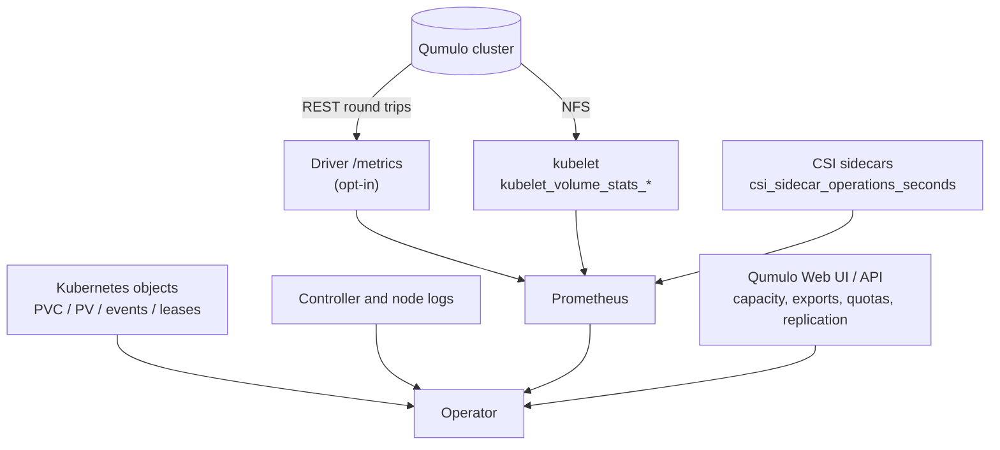

# Observe what the driver is doing

How to answer "what is this driver actually doing, and is it healthy?" —
across metrics, Kubernetes objects, logs and the array itself.

[Monitor the driver](monitor.md) covers the metrics and alerts.
[Collect logs](logs.md) covers log collection. This page is the operator's map
of which signal answers which question.

## The four signal sources



## Which signal answers which question

| Question | Look at |
|---|---|
| Is a volume filling up? | `kubelet_volume_stats_available_bytes` (GA), or `csi_qumulo_volume_used_bytes` |
| Is the array reachable? | `csi_qumulo_api_reachable` — **not** `/healthz` |
| Is the token valid and privileged? | `csi_qumulo_api_requests_total{status="401"}` and `{status="403"}` |
| Are provisions failing, and why? | `csi_qumulo_rpc_total{method=".../CreateVolume",code!="OK"}`, then the controller log |
| Is an operation slow in the driver or in the sidecar's own retries? | `csi_qumulo_rpc_duration_seconds` versus `csi_sidecar_operations_seconds` |
| Is a mount slow? | `csi_operations_seconds` from the kubelet, then the node log |
| How far behind is a DR copy? | `csi_qumulo_replication_recovery_point_age_seconds` |
| Is a volume protected at all? | `csi_qumulo_volume_replication_protected` |
| Did a StorageClass get silently skipped by inventory? | `csi_qumulo_inventory_class_credential_usable` |
| What is actually on the array? | the Qumulo API or Web UI — quotas, exports, snapshots |

## Kubernetes-side observability

The objects worth watching, independent of any metrics stack:

```bash
# claims that are not Bound
kubectl get pvc -A --field-selector status.phase!=Bound

# PVs stuck releasing or terminating
kubectl get pv | grep -vE 'Bound|Available'

# recent storage events across the cluster
kubectl get events -A --field-selector reason=ProvisioningFailed \
  --sort-by=.lastTimestamp | tail -20

# the controller leases -- one holder, renewing
kubectl -n qumulo-csi get lease

# driver registration on every node
kubectl get csinodes -o jsonpath='{range .items[*]}{.metadata.name}{"\t"}{.spec.drivers[*].name}{"\n"}{end}'
```

!!! tip "`ProvisioningFailed` events carry the driver's own message"
    The gRPC status and the text the driver chose are passed through verbatim
    to `kubectl describe pvc`. That message is usually the whole diagnosis —
    read it before reaching for logs.

## Per-volume identification

Metrics identify a volume by `volume_name` and `volume_id` (a digest of its
handle), never by array or path — a deliberate cardinality and
information-disclosure choice. To go from a metric to a real directory:

```bash
PV=<volume-name>
kubectl get pv "$PV" -o jsonpath='{.spec.csi.volumeHandle}{"\n"}'
# -> <server>#<apiUrl>#<realPath>
kubectl get pv "$PV" -o jsonpath='{.spec.claimRef.namespace}/{.spec.claimRef.name}{"\n"}'
```

## Optional: `CSIStorageCapacity`

```yaml
sidecars:
  capacity:
    enabled: true
```

Gives one object per StorageClass, so per-class free space is visible with
`kubectl`:

```bash
kubectl get csistoragecapacity
```

!!! note "Informational, not a scheduling input"
    Every class uses `volumeBindingMode: Immediate`, and Kubernetes consults
    capacity only for `WaitForFirstConsumer` binding. Per-class fault
    isolation comes with it: an unreachable cluster leaves that class's object
    stale while the others keep updating.

## Optional: inventory and health

```yaml
controller:
  inventory:
    enabled: true
sidecars:
  healthMonitor:
    enabled: true
```

`ListVolumes` enumerates the volumes this driver provisioned, per cluster, for
reconciliation and audit. The health-monitor sidecar polls
`ControllerGetVolumeHealth`.

!!! warning "Volume health reaches the claim only from Kubernetes 1.37"
    The RPCs are implemented per CSI v1.13 (`GET_VOLUME_HEALTH`), and the
    health monitor records results in `pvc.status.healthStatus` — which needs
    Kubernetes 1.37 with the `CSIVolumeHealth` gate. On 1.35 and 1.36 nothing
    is recorded, and no kubelet calls the node RPC.

!!! note "Inventory is not a complete picture"
    A DR copy's PV is not listed by the walk, a directory with no quota is
    skipped, and if any cluster cannot be listed the whole call fails rather
    than returning a partial answer. For reconciliation across several
    clusters, listing quotas through the Qumulo API directly is usually the
    better answer.

## Capacity planning signals

| Signal | Watch for |
|---|---|
| `csi_qumulo_cluster_free_bytes` | the real constraint — quotas are logical limits with no pool behind them |
| `csi_qumulo_volume_used_bytes / csi_qumulo_volume_quota_bytes` | volumes approaching their quota (`QumuloCSIVolumeNearQuota`) |
| Sum of quotas versus cluster capacity | deliberate over-commit — expected, but know the number |
| Export table size | one entry per volume on a `dedicated-export` class |
| `csi_qumulo_api_duration_seconds` | array-side slowness before it becomes a provisioning timeout |

!!! warning "Expanding every volume does not reserve anything"
    A directory quota is a limit, not a reservation. Plan real capacity on the
    array.

## Scale considerations

| Dimension | What to know |
|---|---|
| Mounts per node | every pod reaching an array through one address shares **one TCP connection** and slot table; spread floating addresses to spread load |
| Exports | `dedicated-export` adds one export-table entry per volume; `shared-subdirectory` adds none |
| Restores | at most 4 concurrent per controller, each bounded at 50,000 entries / 2 TiB |
| Controller replicas | 2 by default; only the leader acts |
| Qumulo API calls | one client built per request; `qumulo.apiTimeout` is 10 s per call |

## Next

- [Monitor the driver](monitor.md)
- [Collect logs](logs.md)
- [Metrics](../reference/metrics.md)
