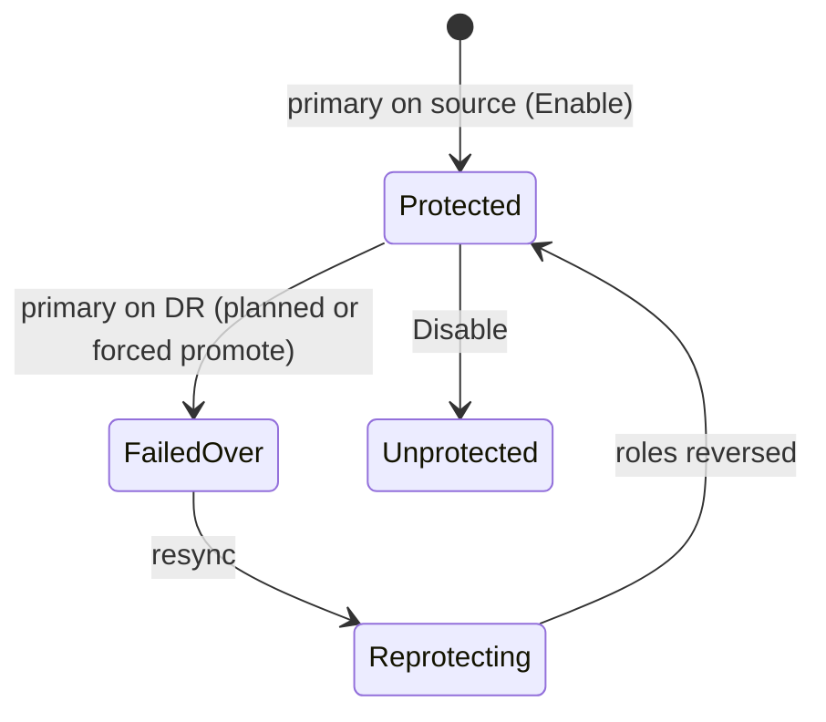

# Replicate to a DR array

!!! note "What has been validated"
    Replication is exercised against a live Qumulo array pair in both
    directions, including planned and forced failover, failback and the group
    form, on a lab EKS cluster with csi-addons v0.15.0.

    The delete and expand **guards** for replicated volumes are always active,
    even with replication disabled.

## Replication and disaster recovery

!!! note "What has been validated"
    Replication is exercised against a live Qumulo array pair in both
    directions, including planned and forced failover, failback and the group
    form, on a lab EKS cluster with csi-addons v0.15.0.

    The delete and expand **guards** for replicated volumes are always active,
    even with replication disabled.

### Setup

```yaml
sidecars:
  csiAddons:
    enabled: true

volumeReplicationClasses:
  - name: qumulo-to-dr
    targetServer: dr.qumulo.example.com
    targetApiUrl: https://dr.qumulo.example.com:8000
    apiUrl: https://array-a.example.com:8000
    replicationMode: continuous          # continuous | policy | policy+continuous
    schedulingInterval: 5m
    secretName: qumulo-replication-tokens
```

!!! warning "`schedulingInterval` is required on a hand-written class"
    The chart always sets it. A `VolumeReplicationClass` you write yourself
    without it is polled only when the relationship is created, before its
    first sync — so `lastSyncTime` stays empty and the replication metrics
    freeze there, with no alert. Class parameters are immutable, so fixing it
    means a new class. See
    [Replication metrics missing or frozen](../operate/monitor.md#replication-metrics-missing-or-frozen).

!!! warning "Fixed REST endpoints are required for DNS-named arrays"
    The runbook recommends a DNS name for the StorageClass `server` precisely
    so it can be flipped at failover. That is also why the controller must
    never dial REST at it — after the flip the name is the *other* array. Both
    the chart and the driver require `apiUrl` whenever a `server` is not an IP
    literal, and `targetApiUrl` whenever `targetServer` is not.

!!! note "One symmetric Secret"
    Either array can be primary after a failover, so the Secret holds a token
    per array keyed by host. Both tokens need the replication privileges on
    top of the ones provisioning uses.

### What each state does

| `VolumeReplication` state | On the source cluster | On the DR cluster |
|---|---|---|
| `primary` | create the relationship, authorize it on the peer, pre-stage the replica's read-only export and quota | **failover**: freeze and drain the source, make the target writable, flip its export read-write |
| `secondary` | freeze this source | — |
| `resync` | — | reverse the relationship, re-apply the class mode, reconnect the old primary as the replica |



!!! warning "Quiesce workloads before a planned promote"
    A frozen source refuses new files but **silently drops appends to existing
    ones**.

### Planned versus forced failover

A planned promote freezes the source and drains on **data** — a marker
snapshot compared against the last replicated snapshot, not a timer — and
promotes only once the target holds everything.

A forced promote always consults the peer first, with bounded retries, so a
transport blip cannot silently turn a planned failover into a forced one.
With the peer genuinely unreachable it promotes at the retained recovery
point.

!!! warning "A plain `Disable` then re-`Enable` is refused, not broken"
    A Disable leaves the DR covering export read-write, and the next Enable
    finds a read-write export it did not make and refuses rather than
    re-protecting over it — so the volume stays unprotected until the export
    is set read-only by hand (D-78). Only an Enable that re-protects a copy
    unchanged since the Disable is allowed through.

### Protecting a `shared-subdirectory` class

A per-volume `VolumeReplication` on such a class is refused: the only
relationship possible is the class-wide one, and driving it from one PVC would
freeze every other tenant's volume at promote.

```yaml
volumeReplicationClasses:
  - name: qumulo-group-dr
    replicationScope: group
```

One relationship covers the class's `basePath`, with a quota per member
volume, and one promote brings the whole class back together. The whole class
is then the unit of failover — which is the point, and the cost.

!!! warning "One `VolumeReplication` per group class, and nothing enforces it"
    A second object on the same group class is not refused — the driver keeps
    no state between requests and the request names no `VolumeReplication`.
    Its Enable is a no-op on the one relationship, and every later verb from
    either object acts on the whole class: deleting either object disables
    replication for every member, and a promote or demote through either moves
    them all.

!!! note "If the group root is removed on the array"
    A group root deleted through Qumulo's own API or UI (`DeleteVolume`
    refuses it) makes every member handle stop resolving. Enable, Demote and
    Info answer `NotFound`, and Disable answers OK so the `VolumeReplication`
    can be deleted — leaving the relationship on both arrays for you to remove
    there.

### The class must name the peer the relationship really uses

A `VolumeReplicationClass` whose `targetServer` names another array, or whose
`targetBasePath` is mistyped, describes a relationship that does not exist.

Enable, Disable, Promote, Demote and Resync all read the configured peer
first. When that peer answers and holds no end of the relationship at the
class's path, the call is refused `InvalidArgument` naming `targetServer` and
`targetBasePath`, and **nothing on either array is changed**. Earlier releases
checked only on Promote and Resync: Enable retried forever, Demote froze the
source, and Disable answered OK having removed only this side's end, leaving
the peer's end behind.

Two shapes are not refused, because the peer holding nothing is what they
are: an `ENDED` end (the peer deleted its half), and a just-created end still
awaiting authorization that names exactly the class's peer and path. A peer
that does not answer is not a refusal either — Demote still freezes with the
peer down, and Disable keeps its unreachable-peer rules.

!!! note "A refused Disable holds the object's finalizer"
    The `VolumeReplication` will not finish deleting until the class is
    corrected; the next attempt then removes both ends.

!!! warning "A first Enable cannot be checked"
    With no relationship anywhere yet, no array can say which peer was meant,
    so a class naming the wrong array protects toward that array. Check the
    class before the first Enable.

### Deleting a protected PVC

`DeleteVolume` refuses while a relationship is rooted at the volume's
directory. Either disable replication first, or put
`replicationDeletePolicy: disable` in the StorageClass's **delete Secret** —
the peer's end is removed first, so an unreachable peer is found before
anything is dismantled.

A volume that is a *replica*, and a *stale source* whose peer has been
promoted, are refused whatever the policy says.

### After a failover: repointing claims

`qumulo-csi-repoint` is a separate binary that repoints DNS-named
claims and restarts pods after a failover. It plans from the live cluster by
default, or from saved objects with `-f` (repeatable; `-` is stdin) — useful
for a review copy, or to plan where the cluster is unreachable:

```bash
kubectl get pv -o json > pvs.json
kubectl get pvc,volumereplication -n apps -o json > apps.json
go run ./cmd/qumulo-csi-repoint failover -namespace apps -f pvs.json -f apps.json
```

Save that input as JSON: YAML takes about three times as long to read, costs
about twice the memory, and a YAML anchor defined in one list item and used in
another is refused. Applying a plan still reads the pods from the cluster.

!!! warning "Quiesce before `switch -dry-run=false`"
    A claim a pod still mounts is not deleted — `kubernetes.io/pvc-protection`
    leaves it `Terminating`, and a replacement applied then lands on the
    half-deleted original. So `switch` deletes nothing unless it can prove no
    pod mounts the claims:

    - Reading from the cluster (no `-f`), it lists the pods in the claims'
      namespaces first and **deletes nothing** if one still mounts a claim, or
      if the client cannot be built or the pod list fails — an unread pod list
      proves nothing.
    - With `-f`, the pods are not read at all, so it **deletes nothing**
      either: it prints the commands to run by hand once the workloads are
      scaled to zero, and exits non-zero.

    After each delete it waits up to 30 s for the claim to be gone. A claim
    still there is reported `NOT DONE`, its replacement is not applied, and the
    run exits non-zero. The dry run is unchanged — it plans either way, and
    says when the apply would refuse.

!!! warning "A failed promote does not undo the promotes that already landed"
    `failover` stops at the first promote that does not reach `Primary` +
    `Completed`, but the copies promoted before it stay writable. The error
    and a `1/4 STOPPED` line name every one. Fix the failed promote and
    re-run; the re-run finds the others already primary.

## Next

- [Recover from data loss](recover.md)
- [Monitor the driver](../operate/monitor.md) — the RPO and protection alerts
