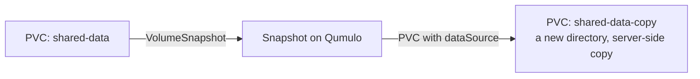

# Restore from a snapshot

Restoring creates a **new** volume from a `VolumeSnapshot`. The source volume
is untouched, and it does not have to still exist.

Take the snapshot first: [Snapshot a volume](snapshot.md).

## Restore to a new volume

```yaml
apiVersion: v1
kind: PersistentVolumeClaim
metadata:
  name: shared-data-restored
  namespace: my-app
spec:
  accessModes: [ReadWriteMany]
  storageClassName: qumulo-nfs
  dataSource:
    name: shared-data-2026-10-16
    kind: VolumeSnapshot
    apiGroup: snapshot.storage.k8s.io
  resources:
    requests:
      storage: 100Gi
```

### What a restore costs

Qumulo has no tree-clone API, so a restore **recreates the tree and copies
each file** server-side. The bytes never pass through the driver, but every
entry costs several round trips: a create, the copy, and a PATCH that sets the
snapshot's mode, owner, group and mtime.

| | |
|---|---|
| Bounded at | 50,000 entries (files and directories) / 2 TiB, then `ResourceExhausted` — decided from the snapshot's own counts **before** anything is copied |
| Large trees | may need several provisioning attempts; the PVC stays `Pending` and each attempt resumes where the last stopped |
| If that is slow | raise `sidecars.provisioner.timeout` — the per-attempt budget derives from it |
| Claim too small | `OutOfRange` naming the bytes needed, before anything is staged — but see the warning below: the check trusts the array's reported snapshot size |
| Concurrency | at most 4 restores per controller |
| Not copied | symlinks and device nodes (skipped, one warning each); ACLs beyond the mode; extended attributes; named streams. Hard links **are** restored as links |

!!! note "A restored volume never appears partially"
    It is assembled under a hidden staging name and renamed into place as the
    final step.

!!! warning "The `OutOfRange` check trusts the array's reported snapshot size"
    That size can be far too small for a snapshot taken immediately after a
    large write — 24 KiB reported for about 1.2 GB of content in testing —
    because it has not settled. A claim smaller than the real content then
    passes the check, the restore succeeds, and the new volume sits over its
    own quota (1.26 GB used against a 1 GiB request, measured). The restored
    data is correct and complete; it is the sizing check that is fooled.

    Size the claim from the **source volume**, not from
    `.status.restoreSize` on the `VolumeSnapshot`. The same behaviour occurs on
    plain Kubernetes; it is not OpenShift-specific.

!!! warning "A restore cannot cross REST endpoints"
    `CreateVolume` dials the endpoint of the **StorageClass the new PVC
    names**, not the endpoint recorded in the snapshot ID. Restoring through a
    VolumeSnapshotClass `apiurl` override therefore needs a StorageClass whose
    own `apiUrl` is that same override.

## Restoring after the source is gone

This works, and it is the case restore exists for: the driver walks the
snapshot by **file ID** rather than by the source's live path, so a deleted
source does not block the restore.

!!! note "A foreign-named snapshot whose source is gone needs consent"
    One taken through `csi-snapshotter` restores normally. One an
    administrator or a backup tool took under its own name needs a
    StorageClass with `allowForeignSnapshotRestore: true`.

## Copy a volume

!!! warning "PVC-to-PVC cloning is not implemented in 0.1.0"
    The driver does not advertise `CLONE_VOLUME`. A PVC with a
    `dataSource` of `kind: PersistentVolumeClaim` is refused.

    ```yaml
    # NOT supported
    spec:
      dataSource:
        kind: PersistentVolumeClaim
        name: shared-data
    ```

Snapshot-and-restore covers the common case, and is the supported way to make
a copy of a volume.

### Copy a volume with a snapshot



**1. Snapshot the source.**

```yaml
apiVersion: snapshot.storage.k8s.io/v1
kind: VolumeSnapshot
metadata:
  name: shared-data-clone-source
  namespace: my-app
spec:
  volumeSnapshotClassName: qumulo-snapshots
  source:
    persistentVolumeClaimName: shared-data
```

**2. Create the copy from it.**

```yaml
apiVersion: v1
kind: PersistentVolumeClaim
metadata:
  name: shared-data-copy
  namespace: my-app
spec:
  accessModes: [ReadWriteMany]
  storageClassName: qumulo-nfs
  dataSource:
    name: shared-data-clone-source
    kind: VolumeSnapshot
    apiGroup: snapshot.storage.k8s.io
  resources:
    requests:
      storage: 100Gi
```

**3. Delete the intermediate snapshot** once the copy is `Bound`, if you do not
want to keep it.

```bash
kubectl -n my-app delete volumesnapshot shared-data-clone-source
```

### What this costs

A restore is a real copy, not a reflink: Qumulo has no tree-clone API, so the
tree is recreated and each file copied server-side with `copy-chunk`.

| | |
|---|---|
| Bounded at | 50,000 entries / 2 TiB |
| Time | proportional to entry count — several round trips per entry |
| Space on the array | the copy is a second full set of data |
| Concurrency | at most 4 restores per controller |

Full detail and the attributes that are not copied:
[What a restore costs](#what-a-restore-costs).

!!! tip "For many identical copies, consider not copying"
    This is an NFS `ReadWriteMany` driver: many pods on many nodes can mount
    the **same** volume concurrently. A read-mostly dataset shared by many
    workloads usually wants one volume and `readOnly: true` volume mounts,
    not N copies.

    ```yaml
    volumeMounts:
      - name: dataset
        mountPath: /data
        readOnly: true
    ```

### Alternatives for bulk copying

| Need | Approach |
|---|---|
| A point-in-time copy inside Kubernetes | snapshot-and-restore, above |
| A copy larger than the restore bounds | copy on the array, or with a Job running `rsync` between two mounted PVCs, then import the result as a [static PV](../provision/import.md) |
| A copy on another array | Qumulo replication — see [Recover from data loss](recover.md) |

## Restore from a backup tool's snapshot

A tool that restores by creating a pre-provisioned `VolumeSnapshotContent`
with an existing `snapshotHandle` — Velero's model — works against this
driver. Verified against a real cluster with a snapshot taken directly through
the Qumulo API.

Build the handle as `<server>##<snapshotID>`, or
`<server>#<apiUrl>#<snapshotID>` when the class sets `apiUrl`.

```yaml
apiVersion: snapshot.storage.k8s.io/v1
kind: VolumeSnapshotContent
metadata:
  name: imported-nightly-0930
  annotations:
    snapshot.storage.kubernetes.io/deletion-secret-name: qumulo-api-token
    snapshot.storage.kubernetes.io/deletion-secret-namespace: qumulo-csi
spec:
  deletionPolicy: Delete
  driver: csi.qumulo.com
  source:
    snapshotHandle: "qumulo.example.com##35372"
  volumeSnapshotRef:
    name: imported-nightly-0930
    namespace: my-app
```

!!! warning "The handle's endpoint must match the restoring StorageClass's"
    Snapshot IDs are per-array numbers: two arrays behind one name number them
    independently. A mismatch is refused with `InvalidArgument`, and the
    message gives the handle to use instead.

!!! warning "Give the content its deletion credential, with the right prefix"
    The prefix must be `snapshot.storage.kubernetes.io/`.
    `snapshot.storage.k8s.io/` is ignored, and the content then stays
    `Terminating` while the snapshot stays on the array.

!!! note "A policy snapshot cannot be imported"
    `ListSnapshots` by ID reports nothing for one, so the content never becomes
    ready, and `DeleteSnapshot` refuses it — the policy owns its lifetime.

Restoring a foreign-named snapshot whose source volume is gone needs a class
with `allowForeignSnapshotRestore: true`. One taken through `csi-snapshotter`
does not.

## Next

- [Snapshot a volume](snapshot.md)
- [Recover from data loss](recover.md)
- [Import an existing directory](../provision/import.md)

