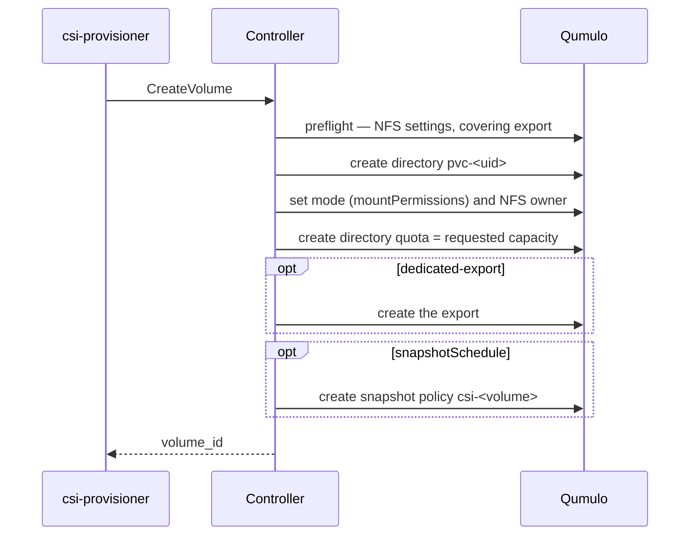

# Provision a volume dynamically

The default path: a PVC names a StorageClass, and the driver creates a
directory with a quota on the Qumulo cluster.

## Create a volume

```yaml
apiVersion: v1
kind: PersistentVolumeClaim
metadata:
  name: shared-data
  namespace: my-app
spec:
  accessModes: [ReadWriteMany]
  storageClassName: qumulo-nfs
  resources:
    requests:
      storage: 100Gi
```

```bash
kubectl apply -f pvc.yaml
kubectl get pvc -n my-app shared-data
```

```console
NAME          STATUS   VOLUME        CAPACITY   ACCESS MODES   STORAGECLASS   AGE
shared-data   Bound    pvc-9f3c...   100Gi      RWX            qumulo-nfs     4s
```

On the array this is `/k8s/volumes/pvc-9f3c...` with a 100 GiB directory
quota.

!!! note "`volumeBindingMode` is `Immediate`"
    An NFS export is reachable identically from every node, so there is no
    topology for the scheduler to resolve. A PVC binds as soon as the volume
    exists, without waiting for a consumer.

## Consume it from many pods

`ReadWriteMany` is the native mode: many pods across many nodes read and write
one volume concurrently.

```yaml
apiVersion: apps/v1
kind: Deployment
metadata:
  name: web
  namespace: my-app
spec:
  replicas: 3
  selector:
    matchLabels: {app: web}
  template:
    metadata:
      labels: {app: web}
    spec:
      containers:
        - name: web
          image: nginx:1.27
          volumeMounts:
            - {name: content, mountPath: /usr/share/nginx/html, readOnly: true}
      volumes:
        - name: content
          persistentVolumeClaim: {claimName: shared-data}
```

!!! warning "`ReadWriteOnce` and `ReadOnlyMany` are intent, not enforcement"
    Both are accepted and neither is enforced: this driver has no attach step,
    and Kubernetes enforces the single-node rule only for drivers that have
    one. Two pods on different nodes can both write a `ReadWriteOnce` volume.
    For a volume that really must have one writer, use `ReadWriteOncePod`,
    which Kubernetes enforces itself — see
    [Access modes](../features/access.md#share-one-volume-between-many-pods).

!!! tip "Give each workload its own subdirectory"
    On a shared volume, use `subPath` per workload. If your pods are non-root,
    read [Non-root pods and `subPath`](../features/mount-options.md#non-root-pods-and-subpath)
    first.

## What happens on the array



!!! note "The quota is the capacity"
    There is no pre-allocation. A volume consumes space as it is written, up
    to its quota, out of the cluster's free space.

## Deleting a volume

With `reclaimPolicy: Delete` (the chart's default), deleting the PVC runs a
Qumulo tree-delete plus quota, export and policy cleanup.

```bash
kubectl -n my-app delete pvc shared-data
```

!!! warning "Several things deliberately refuse a delete"
    - A volume that **is** a replication source or replica — the refusal names
      the relationship and the remedy.
    - A volume another PV still in use names, or a directory below one.
    - A PV that does not **own** its directory: a hand-written or imported PV
      must carry `csi.qumulo.com/delete-directory: "<real-path>"` to opt in.
    - A handle the driver cannot parse.

    A volume counts as deleted only when the cluster itself reports it absent,
    and a PV is never dropped while its directory still exists.

!!! tip "Use `Retain` for anything you would not re-create from scratch"
    ```yaml
    storageClasses:
      - name: qumulo-retain
        reclaimPolicy: Retain
    ```

## Idempotency and retries

A `CreateVolume` cut short by a timeout or a controller restart is resumed by
the provisioner's retry, which adopts the earlier attempt rather than
duplicating it.

!!! warning "One gap: a create cut between the directory and its quota"
    The retry finds the directory there with no quota, refuses to adopt it as
    not driver-provisioned, and fails `already exists` — on that attempt and
    every later one, so the PVC stays `Pending` indefinitely (D-60). The
    directory has to be removed on the array, or given a quota, by hand. See
    [Troubleshoot provisioning](troubleshoot.md).

## StatefulSets

A StatefulSet's `volumeClaimTemplates` gives each replica its own PVC, and so
its own Qumulo directory and quota. Two things are this driver's doing:

- **Scheduling.** Every new PV carries a `nodeAffinity` satisfied by any node
  running the node DaemonSet, so a replica cannot be scheduled onto a node
  without the plugin. If one sticks in `ContainerCreating`, check that its
  node registered the driver — [Verify the installation](../get-started/verify.md#check-every-node-registered-the-driver).

- **Expansion is per claim.** Editing `volumeClaimTemplates` resizes only new
  replicas; patch each existing PVC, which is an online quota change:

    ```bash
    kubectl -n my-app patch pvc data-app-0 --type merge \
      -p '{"spec":{"resources":{"requests":{"storage":"50Gi"}}}}'
    ```

!!! note "Scaling down keeps the claims"
    Kubernetes does not delete `volumeClaimTemplates` claims, so a replica
    scaled back up re-attaches to its existing data. Delete the PVC yourself
    after a permanent scale-down; with `reclaimPolicy: Delete` that removes
    the directory on the array too.

## Volume naming and validation

Kubernetes names volumes `pvc-<uid>`. Names containing `#`, `/` or NUL, and
the names `.` and `..`, are refused before any array call — only a direct CSI
caller can send one.

## Next

- [Expand a volume](expand.md)
- [Snapshot a volume](../protect/snapshot.md)
- [Volume Layout Architecture](../features/layout.md)
