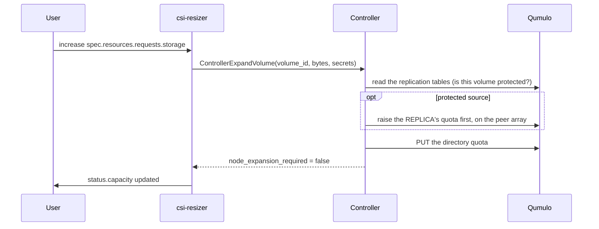

# Expand a volume

Expansion is a **quota change on the Qumulo cluster** — no unmount, no pod
restart, no node-side step. It is the cheapest operation this driver performs.

## Enable it on the class

```yaml
storageClasses:
  - name: qumulo-nfs
    allowVolumeExpansion: true
```

!!! warning "`allowVolumeExpansion` cannot be added to an existing class"
    StorageClass fields are immutable to the API server. Set it from the
    start; otherwise create a new class and migrate.

## Expand a claim

```bash
kubectl -n my-app patch pvc shared-data --type merge \
  -p '{"spec":{"resources":{"requests":{"storage":"200Gi"}}}}'
```

Watch it complete:

```bash
kubectl -n my-app get pvc shared-data -w
kubectl -n my-app describe pvc shared-data | tail -20
```

The PVC's `status.capacity` reaches the new value once the controller has
raised the quota. There is no `FileSystemResizePending` phase to clear,
because no node-side resize is required.



## Expanding a replicated volume

The replica's quota is raised **first** and the source's second, so a source
can never grow past its copy. An unreachable peer leaves both unchanged.

!!! warning "Point the expand Secret at the replication Secret"
    `csi.storage.k8s.io/controller-expand-secret-name` must name the Secret
    that holds both arrays' tokens keyed by address. The driver reads this
    array's key for the expand and the peer's key for the replica-first step.
    Without the peer's key the expand is refused; with the peer not answering
    it is `Unavailable`, with nothing changed.

!!! warning "A stale primary is refused"
    The source end of a relationship whose peer has been promoted — what an
    unplanned failover leaves until the old side is demoted — is refused,
    naming the promoted array, with both quotas as they were. Raising the
    stale copy alone and reporting success left the claim reading a size the
    live copy never had (D-05).

!!! note "Replication ignores the target quota, but clients do not"
    A replica left behind fails the first write after a promote with `ENOSPC`.
    That is exactly why the replica is raised first.

## Limits

| | |
|---|---|
| Shrink | not possible — Kubernetes itself does not permit it |
| Online | yes, always; the volume stays mounted and pods keep running |
| Node-side step | none |
| Effect on existing data | none |
| Effect on free space | none until the data is written; a quota is a limit, not a reservation |

!!! warning "A quota can be raised above the cluster's free space"
    A directory quota is a logical limit with no pool behind it. Expanding
    every volume to a large number does not fail, and does not reserve
    anything — plan real capacity on the array, and watch
    `csi_qumulo_cluster_free_bytes`.

## Verifying on the array

```bash
PV=$(kubectl -n my-app get pvc shared-data -o jsonpath='{.spec.volumeName}')
kubectl get pv "$PV" -o jsonpath='{.spec.csi.volumeHandle}{"\n"}'
# -> qumulo.example.com#https://qumulo.example.com:8000#/k8s/volumes/pvc-...
```

Then read the quota for that path through the Qumulo API or Web UI.

## When expansion fails

| Symptom | Cause | Resolution |
|---|---|---|
| `FailedPrecondition` naming replication privileges | the token lacks `PRIVILEGE_REPLICATION_SOURCE_READ` / `TARGET_READ` | add both — they are required even if you never replicate |
| `FailedPrecondition` naming a promoted array | this is a stale primary | demote or reprotect the old side first |
| `Unavailable` | the array or the peer did not answer | the resizer retries; nothing changed |
| Nothing happens at all | `allowVolumeExpansion` is false on the class | create a new class |
| `InvalidArgument` about shrinking | a smaller size was requested | not supported |

More: [Troubleshoot provisioning](troubleshoot.md).

## Next

- [Snapshot a volume](../protect/snapshot.md)
- [Monitor the driver](../operate/monitor.md)
