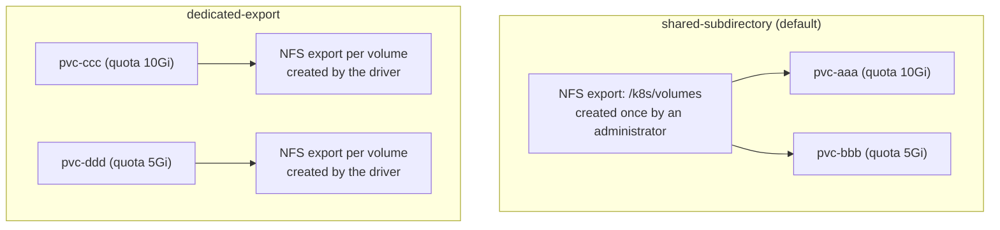
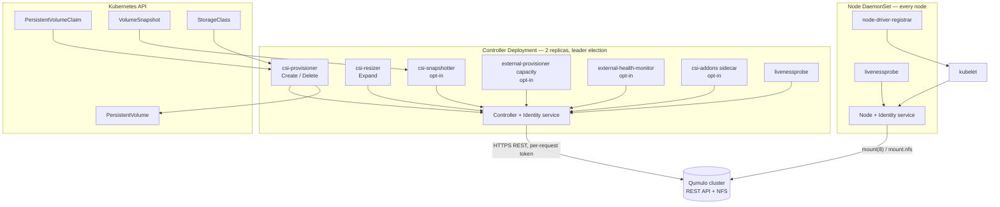
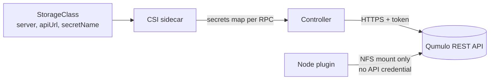
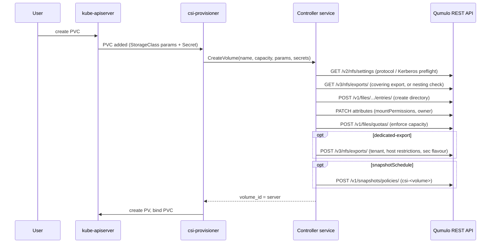
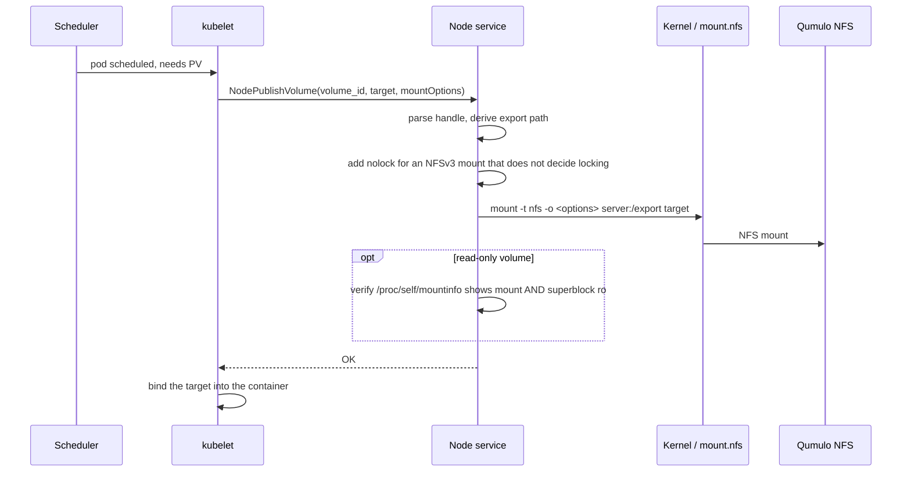
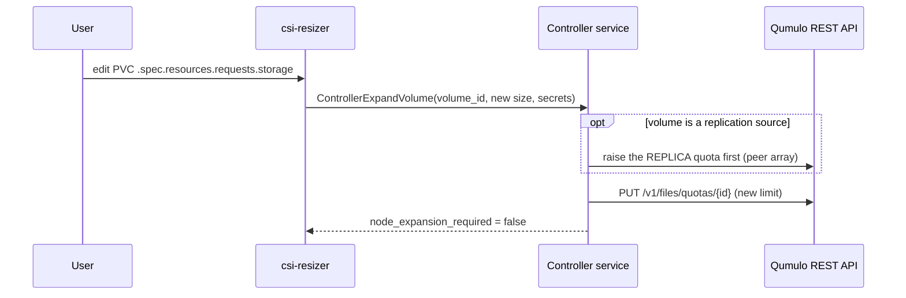
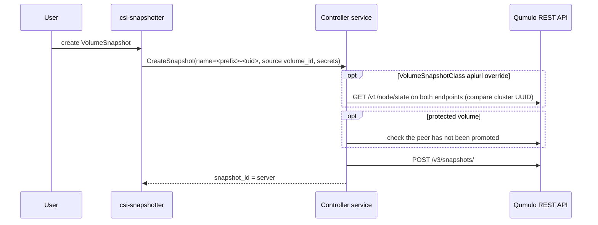

# Architecture

The driver follows the standard CSI decomposition: one **Identity**, one
**Controller** and one **Node** service, driven by the upstream Kubernetes CSI
sidecars. One binary implements all three; the `-mode` flag selects which are
served, and each image sets its own `CMD` so no deployment inherits the
binary's local-development `all` default.

## Volume model

A volume is a **directory on the Qumulo cluster with a directory quota**. The
quota is what makes a PersistentVolume's capacity real, and it is also how the
driver recognises its own volumes: a directory with no quota is treated as not
driver-provisioned.

Two provisioning models decide where that directory lives and how it is
exported.

| Model | What it creates | Who owns the export |
|---|---|---|
| `shared-subdirectory` (default) | a directory beneath `basePath` | an administrator, once, covering `basePath` |
| `dedicated-export` | a directory **and** its own NFS export | the driver, per volume |



`dedicated-export` is what makes per-volume access control possible —
`allowedClients`, `tenantID` and Kerberos all require it. It costs one entry in
the cluster's export table per volume, which is worth knowing before using it at
scale.

!!! warning "Under NFSv4 the two models want opposite things"
    `shared-subdirectory` needs `basePath` covered by an export.
    `dedicated-export` needs no ancestor of it exported, because NFSv4 refuses
    nested exports. They cannot both serve one `basePath` — give each model its
    own subtree. See [KI-1](../provision/troubleshoot.md#dedicated-export-refused-under-nfsv4).

## Components



### Controller service

Runs as a Deployment, two replicas by default with leader election, soft
anti-affinity and a PodDisruptionBudget. It implements `CreateVolume`,
`DeleteVolume`, `ControllerExpandVolume`, the snapshot RPCs, `GetCapacity`,
`ListVolumes`/`ControllerGetVolume` (opt-in) and
`ControllerGetVolumeHealth`.

It speaks only HTTPS to the Qumulo REST API and touches no filesystem, so it
runs a distroless image as `USER 65532:65532`.

### Node service

Runs as a DaemonSet on every node, as root and privileged, because mounting in
the host namespace requires it. It implements `NodeStageVolume`-less
publishing (`NodePublishVolume` / `NodeUnpublishVolume`),
`NodeGetVolumeStats` and `NodeGetVolumeHealth`.

Mounting is performed by `k8s.io/mount-utils`, which execs `mount(8)` — so the
node image carries `nfs-common`, `mount` and `netbase`, and uses `tini` as PID 1
so a helper orphaned by a killed forced unmount is reaped.

!!! note "No `ControllerPublishVolume`, and therefore no attacher"
    `CSIDriver.attachRequired` is `false`. The driver publishes no
    `VolumeAttachment`, so the chart deploys **no `csi-attacher`**. With
    `attachRequired: true` every pod would block on an object nothing fulfils.

### Sidecars

| Sidecar | Default | Purpose |
|---|---|---|
| `csi-provisioner` | always | `CreateVolume` / `DeleteVolume`, and resolving a PVC `dataSource` for restore |
| `csi-resizer` | always | `ControllerExpandVolume` |
| `node-driver-registrar` | always | registers the plugin with the kubelet |
| `livenessprobe` | always | both pods |
| `csi-snapshotter` | off | snapshots; needs the cluster-wide snapshot CRDs |
| external-provisioner capacity mode | off | `CSIStorageCapacity` per StorageClass |
| `external-health-monitor` | off | polls `ControllerGetVolumeHealth`; needs inventory |
| csi-addons | off | `VolumeReplication` |

!!! warning "`csi-snapshotter` is off by default on purpose"
    It cannot start without the cluster-wide snapshot CRDs, and a container
    that will not start takes the whole controller pod — provisioning
    included — with it.

### Storage backend integration

Every Qumulo interaction is a REST call over HTTPS, authenticated with a bearer
token resolved per request. The driver uses directory entries, file attributes,
directory quotas, tree-delete jobs, snapshots, snapshot policies, NFS exports
and settings, network tenants, and the replication relationship tables. The
complete endpoint-to-privilege mapping is in
the privileges the Qumulo API token carries.

## Stateless and multi-cluster

One deployed controller serves many Qumulo clusters. It holds no cluster
address and no standing API client: for every request it builds a client from
that request's StorageClass parameters (`server`, `apiUrl`) and the credential
the request carries. A request without them fails rather than falling back to a
process-wide credential.

Three consequences you can rely on:

- No credential is cached between requests, so a rotated Secret takes effect on
  the next call with no restart.
- One Helm release can serve two Qumulo clusters — one StorageClass and one
  Secret per cluster.
- `Probe` reports the driver's own liveness only. It contacts no cluster, so
  `/healthz` says nothing about whether an array is reachable.

Two RPCs are the exception, and they are opt-in for exactly that reason:
`ListVolumes` and `ControllerGetVolume` must list StorageClasses through the
Kubernetes API to discover clusters no request named. See
[Several Qumulo clusters](../features/multi-cluster.md).

## Credential flow



The node service never calls the Qumulo API, so a cluster-wide credential never
reaches a worker node. This is also why the two images differ: the controller
is distroless, the node image carries an NFS client userland because
`mount(8)` and `mount.nfs` are what perform the mount.

## Volume handles

A volume ID encodes everything a later operation needs, because `DeleteVolume`,
`ControllerExpandVolume` and the snapshot RPCs are handed no StorageClass
parameters:

```
<server>#<apiUrl>#<realPath>
```

A snapshot handle is `<server>#<apiUrl>#<snapshotID>`; with no endpoint it is
`<server>##<snapshotID>`, which means `https://<server>:8000`.

!!! warning "Snapshot IDs are per-array numbers"
    Two arrays behind one DNS name number their snapshots independently, which
    is why the endpoint is recorded in the handle and why a mismatch is refused
    rather than guessed at.

## Volume provisioning flow



!!! note "Retries adopt, they do not duplicate"
    A `CreateVolume` cut short by a timeout or a restart is resumed by the
    retry, which adopts the earlier attempt's state. The one gap is a create
    interrupted *between* making the directory and setting its quota — see
    [D-60 in the feature list](../reference/supported-features.md#1-volume-lifecycle).

## Mount flow



Unpublish runs a bounded ladder: a plain `umount(8)`, then `umount -f`, then
`umount -l`, returning success only once the target has left `/proc/mounts`.

## Expansion flow



No unmount, no pod restart, no node-side step: the quota is the capacity.

## Snapshot flow



Restore runs through `CreateVolume` with a snapshot `dataSource`: the tree is
recreated and each file copied server-side with `copy-chunk`, assembled under a
hidden staging directory and renamed into place, so a volume is never observable
half-restored. See [Restore from a snapshot](../protect/restore.md#what-a-restore-costs).

## Limitations

- No raw block volumes — this is an NFS file driver.
- No PVC-to-PVC cloning. Snapshot-and-restore covers the common case.
- No volume shrink (Kubernetes does not permit it).
- No NFSv4.0 or NFSv4.2 — only NFSv3 and NFSv4.1.
- No ACL management: the driver sets a POSIX mode, nothing more.

The complete list, with the reasoning behind each:
[Supported features](supported-features.md) and
[Features](../features/index.md).

## Next

- [Supported features](supported-features.md)
- [Features](../features/index.md)
